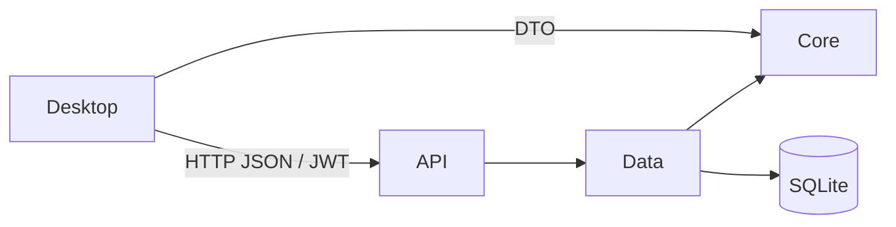

# Архитектура

| Проект | Ответственность |
| --- | --- |
| StockDesk.Core | Сущности, правила смены статуса, DTO, импорт и экранирование CSV. |
| StockDesk.Data | EF Core, миграция SQLite, внешние ключи, индексы и контроль версии. |
| StockDesk.Api | Локальное HTTP API, вход, права ролей, сводка, обмен файлами. |
| StockDesk.Desktop | WPF-формы и запуск локального API. Общие DTO берёт из Core. |
| StockDesk.Tests | Проверки правил Core и интеграционные проверки API. |
| StockDesk.UiTests | Проверки фильтра, вариантов перехода и открытия WPF-окна. |

Заявка `Shipment` относится к одному покупателю и может ссылаться на кладовщика. `Shipment.Advance` проверяет допустимость перехода, обновляет нужные даты и увеличивает `Revision`. API проверяет полномочия роли и принадлежность заявки до изменения.
