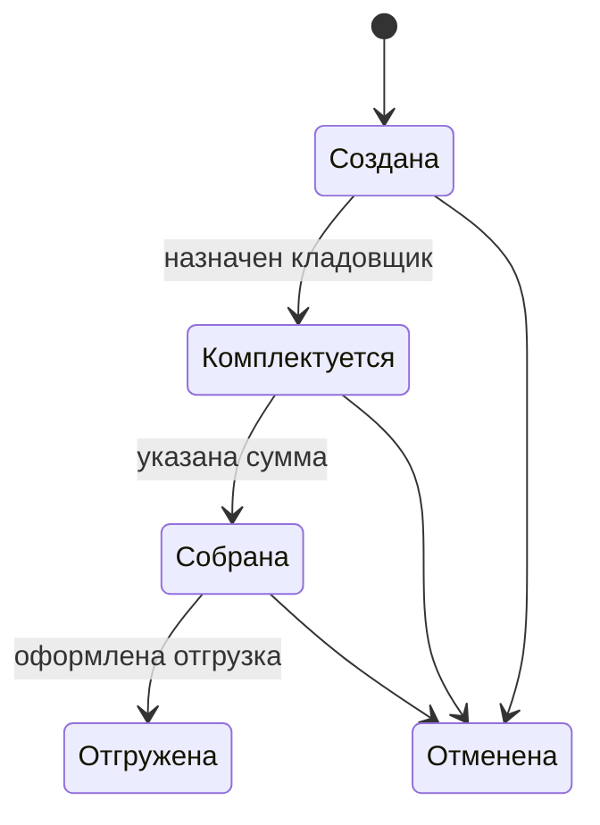

# Требования варианта 17

Склад оптовой фирмы обрабатывает заявки на отгрузку. Для каждой заявки сохраняются покупатель, адрес, товары, исполнитель, статус и сумма.

| ID | Что требуется |
| --- | --- |
| F01 | Вход и выход для администратора, менеджера и кладовщика. |
| F02 | Менеджер и администратор регистрируют заявку на покупателя. |
| F03 | Назначение кладовщика при переходе к комплектации. Назначенный кладовщик отмечает сборку и вводит сумму. |
| F04 | Менеджер и администратор отмечают отгрузку или отменяют заявку до отгрузки. |
| F05 | Поиск по номеру, покупателю, адресу и товарам совместно с фильтром статуса без дополнительной кнопки. |
| F06 | Менеджер и администратор ведут справочник покупателей и загружают CSV. |
| F07 | Администратор создаёт учётные записи и выгружает заявки в CSV, JSON и XML. |
| F08 | Отчётность показывает число заявок, суммы отгрузок и распределение по статусам. Кладовщик видит сводку по назначенным заявкам. |

Условия запуска: Windows x64, WPF и .NET 8. API слушает localhost, SQLite сохраняется вне исходников. Сумма сборки от 0,01 до 1 000 000 ₽ с точностью до копеек. Каждая смена статуса сверяет номер версии записи.

- Менеджер регистрирует заявку и назначает кладовщика, чтобы начать комплектацию.
- Кладовщик открывает свои заявки и подтверждает сборку, чтобы менеджер мог отметить отгрузку.
- Администратор выгружает заявки, чтобы передать сводку о работе склада.
